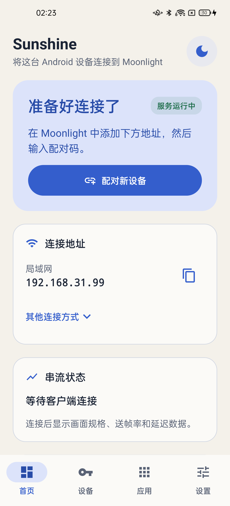
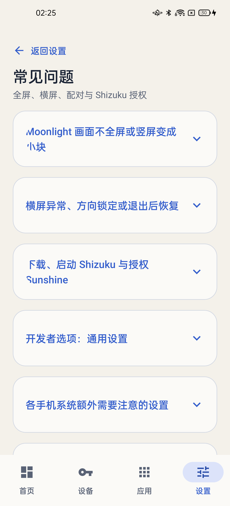
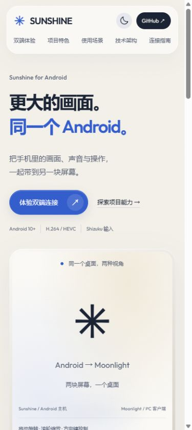
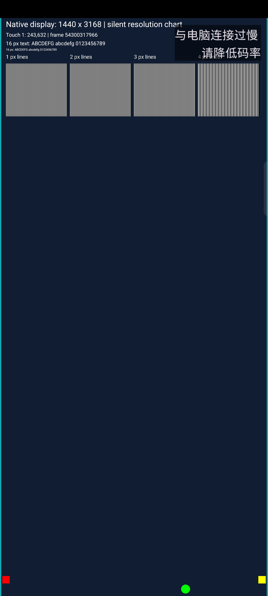
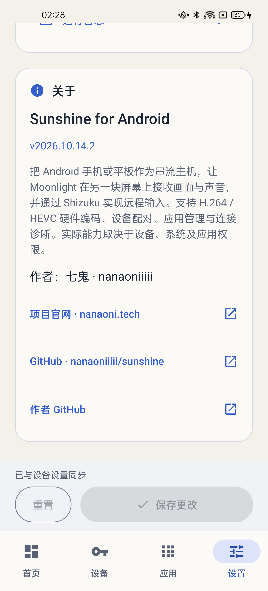

# Sunshine for Android

把 Android 手机或平板作为串流主机，在另一块屏幕上接收画面与声音，并远程操作。支持 Moonlight，也支持基于串流协议开发自定义接收端。

[](https://github.com/nanaoniiiii/sunshine/releases)
[](https://github.com/nanaoniiiii/sunshine/releases/latest)
[](https://nanaoni.tech)
[](https://github.com/RikkaApps/Shizuku)

**[访问官网](https://nanaoni.tech) · [下载安装包](https://github.com/nanaoniiiii/sunshine/releases/latest) · [常见问题](docs/faq.md) · [反馈问题](https://github.com/nanaoniiiii/sunshine/issues)**

作者：[七鬼 · nanaoniiiii](https://github.com/nanaoniiiii)。

## 实机与官网

<table width="100%">
  <tr><th width="33%">Sunshine 主机<br>OPPO Android 11</th><th width="33%">常见问题<br>设置 → 维护</th><th width="33%">官网<br>nanaoni.tech</th></tr>
  <tr>
    <td width="33%" align="center"></td>
    <td width="33%" align="center"></td>
    <td width="33%" align="center"><a href="https://nanaoni.tech"></a></td>
  </tr>
</table>

<details>
<summary>查看接收端画面与关于栏</summary>

<table width="100%">
  <tr><th width="33%">接收端示例<br>三星 Android 13</th><th width="33%">项目介绍<br>作者与链接</th><th width="33%">项目入口</th></tr>
  <tr>
    <td width="33%" align="center"></td>
    <td width="33%" align="center"></td>
    <td width="33%" align="center"><a href="https://nanaoni.tech">访问官网</a><br><br><a href="https://github.com/nanaoniiiii/sunshine">GitHub 仓库</a><br><br><a href="https://github.com/nanaoniiiii">作者：七鬼</a></td>
  </tr>
</table>

</details>

以上应用截图截取自 v2026.10.14.1–v2026.10.14.2，可能与您使用的版本有所出入。

## 项目能力

- **高效硬件编码**：通过 Android AMediaCodec 提供 H.264 / HEVC 硬件编码，支持自动选择和指定编码器，让画面实时抵达另一端。
- **灵活全屏与方向切换**：支持原生尺寸采集、按连接请求分辨率切换全屏，支持画布随设备横竖屏切换，以及固定画布旋转兼容模式，并在串流结束后恢复显示设置。
- **免 Root 远程输入**：通过 Shizuku 实现触控、鼠标与键盘操作，支持点击、拖拽和多点手势，让接收端也能自如控制 Android。
- **实时音频内录**：结合 Android AudioPlaybackCapture 与 Opus 编码，将画面和声音一起带到另一块屏幕。
- **便捷配对与应用管理**：PIN 设备配对、实时连接状态、桌面与应用快捷入口，连接后即可开始使用。
- **流畅串流与自动恢复**：独立引擎进程、连接自愈、音视频队列优化、帧率与码率控制、远程唤醒，保持操作连贯。
- **自动保存与实时诊断**：修改设置自动保存，连接诊断、运行日志与应用内常见问题帮助您快速上手。
- **开放接收端生态**：可使用 Moonlight，也可围绕串流协议开发自己的接收端。

## 快速开始（以 Moonlight 为例）

1. 准备 Android 10 或以上手机／平板，以及能运行 Moonlight 的电脑、手机或其他客户端，两端接入同一可互通的局域网。
2. 在 [Releases](https://github.com/nanaoniiiii/sunshine/releases/latest) 下载 APK：多数现代手机选 `arm64-v8a`；32 位 ARM 选 `armeabi-v7a`；不确定时选 `universal`。若通用包以 ZIP 提供，请先解压其中的 APK 再安装。
3. 安装并启动 [Shizuku](https://github.com/RikkaApps/Shizuku/releases)，按[官方手册](https://shizuku.rikka.app/zh-hans/guide/setup/)完成无线调试或电脑 USB 启动。
4. 打开 Sunshine，在主页授予 Shizuku 及提示的录屏、录音、通知权限，确认服务运行，记下主机 IP。
5. 在 Moonlight 添加该 IP，点击主机，在 Sunshine 弹窗或“设备”页输入 **Moonlight 显示的 4 位 PIN**，然后选择桌面或应用开始串流。

系统无线调试配对用于启动 Shizuku，Moonlight PIN 配对用于连接 Sunshine，是两个独立流程。

## 使用指南

- [全屏与画面比例设置](docs/faq.md#moonlight-画面不全屏或竖屏变成小块)
- [横竖屏切换与显示恢复](docs/faq.md#横屏异常方向锁定或退出后恢复)
- [Shizuku 下载、启动与授权](docs/faq.md#下载启动-shizuku-与授权-sunshine)
- [Sunshine 与接收端配对](docs/faq.md#sunshine-与-moonlight-怎么配对)

## 从源码构建

应用使用 Kotlin、Jetpack Compose / Material 3 与原生 Android 串流引擎。需要 JDK 17、Android SDK 34；最低 SDK 29。仓库包含两种 ARM ABI 的原生库。

```powershell
git clone https://github.com/nanaoniiiii/sunshine.git
cd sunshine
./gradlew.bat :app:assembleRelease :app:testDebugUnitTest :app:lintRelease
```

macOS／Linux 使用 `./gradlew`。APK 位于 `app/build/outputs/apk/release/`。发布构建启用 R8 和资源压缩，沿用项目现有签名配置。

需要重新构建原生引擎时，请先阅读[原生构建说明](native/README.md)。`native/sources.lock.json` 固定上游和依赖版本；`native/android/` 保存本项目独立实现的 Android 平台适配。

## 工程记录

- [v2026.10.14.3：官方 Sunshine 引擎、自动保存与输入提交](docs/validation/v2026.10.14.3.md)
- [v2026.10.14.2：帮助、关于与仓库更新](docs/validation/v2026.10.14.2.md)
- [v2026.10.15.1：直接安装的小体积 APK](docs/validation/v2026.10.15.1.md)
- [v2026.10.14.4：原生画布旋转与手机全屏兼容](docs/validation/v2026.10.14.4.md)
- [v2026.10.14.1：默认竖屏、按连接全屏与退出恢复](docs/validation/v2026.10.14.1.md)
- [后端架构与性能优化](docs/backend-optimization.md)
- [原生视频控制](docs/native-video-controls.md)
- [网络反馈](docs/network-feedback.md)
- [队列、编码器与远程唤醒](docs/queue-encoder-controls.md)

单元测试覆盖会话恢复、设置校验、采集几何与全屏恢复，配合实机操作检查，持续完善串流体验。

## 开源致谢

- [Sunshine](https://github.com/LizardByte/Sunshine)：GameStream 服务端。
- [NanoHTTPD](https://github.com/NanoHttpd/nanohttpd)：轻量级 HTTP 服务。
