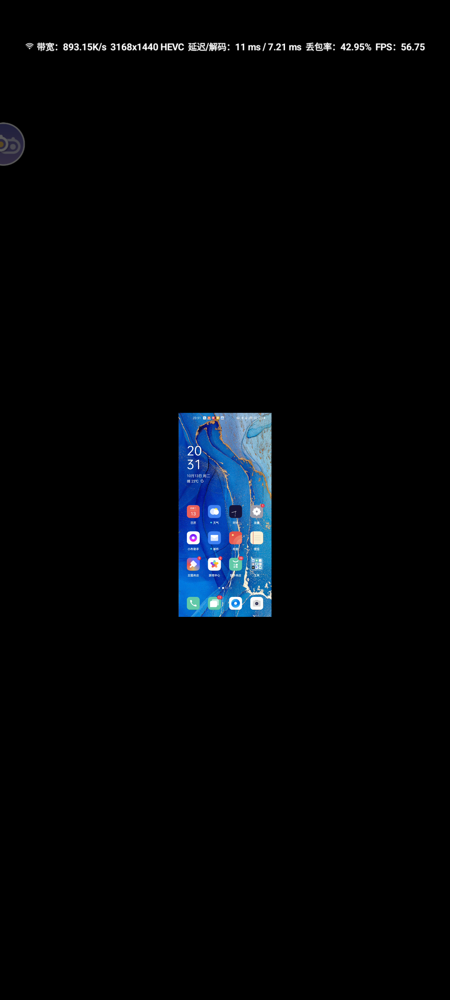
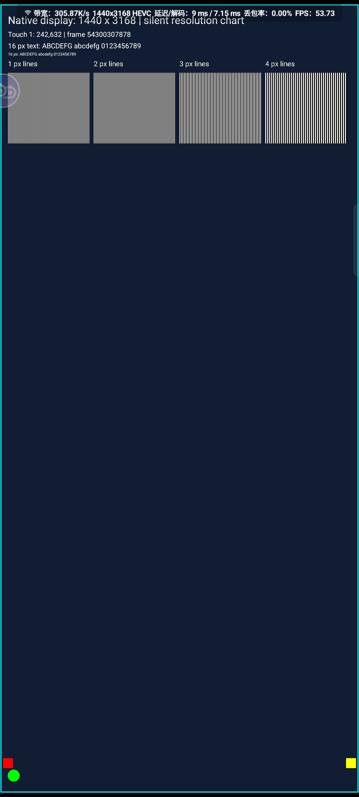

# 默认竖屏与按连接全屏验证 · v2026.10.14.1

2026-10-14，北京时间。OPPO PDEM10 Android 11 为 Sunshine 主机，三星 SM-G986U1 Android 13 为 Moonlight 客户端。新版已原签名覆盖安装到 OPPO，保留配对及数据。55 项 JVM 测试通过，Release 构建通过；Lint 0 错误、26 警告。

## 默认竖屏小画面的原因与处理

已在阿西西版实际复现：主机显示 1440×3168 竖屏，Moonlight 请求 3168×1440 横屏，用户再把客户端页面切成竖屏。服务端先把竖屏内容缩进横屏视频，客户端又把横屏视频缩进竖屏页面，形成居中的小画面；提高码率不能恢复第一次缩小丢失的细节。仅旋转客户端页面不会重新协商视频宽高。

本次已逐个设置三星主用户中的三个客户端并实测。默认主机采集保持 1440×3168；三个客户端实际协商的视频均为 **1440×3168**，编码目标 viewport 均为 **[0,0,1440,3168]**，实际截图铺满宽度，不再出现中央小块。三星物理屏幕为 1440×3200，尺寸比例略有不同，安全区及极薄上下边缘仍可能存在。

另外读取阿西西版正在播放的视频 Surface：`activeBuffer=[1440x3168]`，屏幕可见区域为`[0,16,1440,3184]`，确认1440宽的视频缓冲直接覆盖1440宽显示区域。三星对应用UI采用1080×2400兼容缩放，但这次视频Surface仍为1440×3168，不能把UI缩放直接等同于视频降为1080p；记录见`client-video-surface.txt`。

| 客户端 | 当前配置 | 实测 |
|---|---|---|
| V+ 12.13.0 | 自定义1440×3168；跟随设备旋转开；交换宽高关 | H.264、1440×3168；默认画面铺满宽度 |
| Artemis 20.2.6 | 自定义3168×1440；自动屏幕方向、自动反转分辨率开；视频缩放模式“填充” | HEVC、实际1440×3168；消除左右窄边 |
| 阿西西 26.09.12 | 配置A自定义1440×3168；横竖屏自由切换、填充刘海区域开；拉伸至全屏关 | HEVC、1440×3168；像素图边框及小字可见 |

“填充”可能轻微裁去边缘，和拉伸变形不同。横屏使用时应请求3168×1440并让客户端页面保持横屏；不应把已协商的横屏视频只通过旋转页面变成竖屏。服务端不能替第三方 Moonlight 修改这些显示设置。本次改变的是这台三星主用户的客户端配置，不代表安全文件夹、其他用户或其他手机会自动同步。

截图保留原始分辨率，可打开 PNG 查看细节。下面为阿西西版复现与修正后的实际截图：

## 新版服务端行为

默认使用 Sunshine 主机当前显示尺寸采集；客户端接入不自动改变主机画布。主页连接旁的“全屏”按钮按该连接实际请求的宽高修改主机显示及采集尺寸，各端编码器与会话保留。

本次修正：强制使用选定的显示方向，避免竖屏应用覆盖普通旋转锁；按物理 display 0 读取旋转策略，忽略虚拟采集显示；兼容 OPPO 的 wm help 返回255但输出正常帮助的行为，修改命令仍严格要求退出码0。第一次选择全屏前保存原尺寸、用户旋转和方向策略，最后一个连接退出后恢复；进程重新启动且空闲时也尝试恢复保存的原设置。这轮实际确认正常退出恢复，以及覆盖安装重新启动后的恢复日志；未模拟所有崩溃方式。

## 两路连接切换

Artemis 1440×3168 和 Windows Moonlight 1920×1080 同时接入。连续6个诊断快照中，两路 ID **18352395255809 / 18352395255810** 保持一致，两个编码帧计数持续增加，打包脚本已断言这些条件。

| 操作 | 采集 | 目标 viewport | 结果 |
|---|---|---|---|
| 切换前，两路均在线 | 1440×3168 | 手机[0,0,1440,3168] | 电脑按竖屏内容留边 |
| 选择电脑全屏 | 1920×1080 | 电脑[0,0,1920,1080] | 两路保持连接 |
| 返回OPPO桌面、再进入Sunshine | 1920×1080 | 电脑[0,0,1920,1080] | 桌面未把系统显示方向改回竖屏 |
| 选择手机全屏 | 1440×3168 | 手机[0,0,1440,3168] | 两路保持连接；手机实际画面铺满宽度 |
| 退出电脑，手机仍在线 | 1440×3168 | 手机仍满画布 | 强制方向策略仍保持 |
| 退出最后一个手机连接 | 原生1440×3168、无覆盖尺寸 | 无编码目标 | 旋转0、原强制方向策略false已恢复 |

主页按钮实际点击测试也通过，截图显示“已按1440×3168全屏显示”。双连接切换用的是按钮调用的同一运行时 API。与原v2026.10.13.2行为不同，现在全部连接退出后会恢复原显示设置。

## 仍存在的边界与现象

- 共享主机画布同一时刻匹配一个选定端。不同宽高比的其他端会保留自己的编码尺寸并留边，无法同时让所有比例无裁切地铺满同一画面。
- **OPPO桌面本身不支持正常横屏布局。** 强制横屏后系统采集确实为1920×1080，但桌面内容仍在中间竖向区域，且图标布局异常。`portrait-final-pc-home-settled.png`明确保留这个反例，不能把完整编码viewport等同于任何应用都铺满。正常默认竖屏桌面已铺满宽度。
- 切换和桌面负载中出现队列丢帧、瞬时降帧、客户端“连接过慢”提示；两路持续编码并不断连不等于零丢帧。静音像素图的阿西西和V+单连接样本没有队列丢帧，但未完成长时间游戏、WAN、HDR或全部OEM验证，未量化端到端清晰度/音频连续性。
- Windows客户端首次加入发生一次RTSP握手失败，重试成功后再验证双路切换；没有改动该握手路径。Windows图形捕获截图混入其他桌面内容，未用其作为全屏画面证据。
- 64位包完成实机安装；32位及通用包完成构建，32位设备未实测。

## 页面视觉检查

已检查原生Android真机截图，覆盖主页、滚动后的串流状态/设备准备、按钮反馈和横屏页面。竖屏按钮与对应请求分辨率同行，没有按钮文字溢出。滚动截图顶部内容部分离开视口属于正常滚动；横屏1080高度加原640密度下可见内容较少，需滚动。成功提示短暂覆盖底部正文，关闭后恢复。

环境没有用户指定的browser-harness及vision.py，原生Compose页面也不由dev server渲染，因此以ADB真机截图和当前视觉模型检查实际画面，没有以代码推断布局。电脑状态检查使用computer-use 技能。

## 文件

`Sunshine-v2026.10.14.1-arm64-v8a.apk`为推荐安装包；`Sunshine-v2026.10.14.1-universal.apk`为通用包。`portrait-fullscreen-fix.patch`是相对于v2026.10.13.2的本轮增量，保留已有其他改动。`portrait-session-evidence.json`为原始诊断快照，`portrait-fullscreen-evidence.zip`包含报告、截图、补丁、视频Surface及恢复记录。
